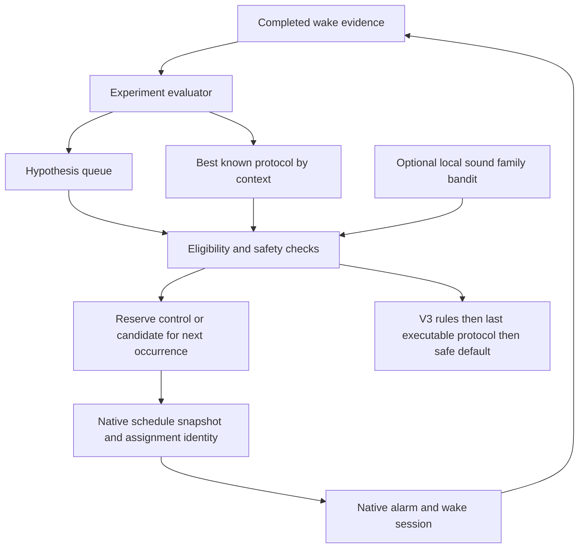

# V4 implementation plan

Status: 4A.1 storage and 4A.2 native execution integration implemented locally;
field acceptance remains open. See [native integration](V4A_NATIVE_INTEGRATION.md).
Baseline: V3.0.4 (7), commit 4c0d58a. This document supersedes the earlier V4
proposal in the version timeline. Product scope follows the Phase 4 requirements
provided on 24 October 2026. Phase names below follow that document's A–J loops.

## 1. Integration assessment

- Flutter/Riverpod own presentation and application orchestration. Drift stores
  domain evidence; Kotlin owns scheduling, cold starts, playback and retries.
- `wake_protocols` stores versioned executable settings, reason and lineage.
  `protocol_evaluations` records one evaluation per session. `wake_sessions`
  contains protocol ID/version/snapshot and analysis status. Separate events,
  mission attempts and follow-up checks remain the source evidence.
- `WakeProtocolRepository` builds manual versions, validates capabilities and
  resolves executable fallback. `AdaptiveWakeCoordinator.processPending()`
  analyzes completed sessions, invokes V3 rules and reschedules future alarms.
- `AlarmAdaptationPolicy` controls sound, volume, vibration, mission and wake
  check separately, with a user volume cap. Mission adjustment defaults to fixed.
- `AdaptiveThresholds` version 1: response bands 15/30/60 seconds; minimum
  comparable baseline 3, adequate 7; sound-decline baseline 4 uses/recent 3 uses,
  ratio 1.3 and minimum 8 seconds. These remain product heuristics.
- Drift starts at schema 5. Additive migrations and schema snapshots already
  cover versions 1, 3, 4 and 5. Never rewrite existing wake history.
- No experiment assignments, comparison engine, context preferences or bandit
  currently exist. Native assignment must be selected and persisted before the
  trigger; choosing after the wake would contaminate the comparison.
- V3 phone acceptance remains open, including walking accuracy and native UI
  instrumentation. Development can proceed locally; enabling learning and
  claiming reliable field operation require those gates.

## 2. Architecture

Pure Dart domain services make reproducible decisions. Drift repositories own
transactions. A scheduling coordinator selects a snapshot for an occurrence and
sends it through the existing typed bridge. Native triggers only execute saved
settings, preserving decisions across reboot and absent Dart. V3 and experiment
adaptation must not concurrently change a running experiment's variants.

## 3. Records and lifecycle

### WakeExperiment

ID, alarm ID, name, concrete hypothesis, dimension, control/candidate protocol
IDs and versions, immutable executable snapshots, context key, status, start/end
times, minimum/preferred/maximum valid sessions per variant, result, winner,
confidence, created/updated times, and invalidation reason. Counts are derived
from valid completed assignments so retries cannot inflate them.

`draft → ready → running ↔ paused → completed`.
Draft/ready/running/paused may become cancelled or invalidated. Terminal states
cannot reopen. At most one ready/running/paused experiment per alarm. Variant
settings, context, hypothesis and sample policy are frozen at creation; changing
them creates another experiment. Audit each state transition with its reason.

### ExperimentSession

ID, experiment ID, alarm occurrence timestamp, assigned variant, protocol ID/
version, context key, assigned timestamp, optional wake-session ID, completion
timestamp, validity (`partial`, `valid`, `invalid`) and invalid reason.

Reserve by alarm plus scheduled occurrence before scheduling/triggering. The
wake-session ID is initially absent because native creates it on trigger.
Reconciliation attaches the observed session only if alarm, scheduled timestamp,
executed protocol ID/version/snapshot and assignment-before-trigger agree. A
session can attach only once globally. A retry/snooze stays with its original
session and assignment. Never assign past wakes retrospectively.

### Audit

Append-only experiment events: created, state changed, occurrence assigned,
session attached, session completed, invalidated, result accepted/rejected,
preference updated and reset. Store ordered sequence, timestamp, rule/version and
minimal structured details. Keep private URIs/QR data out of public UI summaries.

## 4. Migration and ownership

Schema 6 first adds `wake_experiments`, `experiment_sessions` and
`experiment_audit_events`; preserve all existing tables and rows. Add unique
occurrence and wake-session indexes, one-open-experiment index, and guards for
immutable snapshots/assignments and append-only audits. New installs and upgrades
must create the same constraints. Export schema 6 and regenerate migration test
helpers; retain every historical snapshot.

Context preferences, queue, best-known provenance and bandit statistics arrive
in later reviewed additive migrations. Use a separate native runtime migration
for occurrence assignment identity in the 4A scheduling integration. Native never writes Drift's database.
No schema change or APK version bump means a feature is accepted by itself.

## 5. Assignment and validity

- Start with sound family only. A bundled sound ID, URI and family together
  constitute that dimension. Compare every executable field, including mission
  JSON and vibration escalation; ignore identity/lineage and derived intensity.
- Initial volume, volume ramp, vibration, check delay, check hold, mission type,
  mission difficulty and retry policy each have explicit allowed field groups.
  Exactly one group changes, and it must make an executable difference.
- Use deterministic control/candidate alternation over reservations. Include
  invalid/partial reservations in the assignment sequence so a bad outcome
  cannot cause a favorable reassignment. Repeated reservation returns the same
  assignment. No random choice is needed for A/B comparisons.
- Fixed dimensions, disabled adaptation/experiments, critical alarms, recent
  severe failures, missing sounds/capabilities and volume caps reject selection.
  Safety is rechecked immediately before native scheduling.
- Structural and completeness problems exclude a record from comparison.
  A failed but fully observed wake is still evidence, not an invalid sample.
  Emergency bypass is adverse evidence and an early-stop signal; don't hide it.
- Invalidate on changed tested settings, changed user bounds/context, removed
  sound, missing capability or mismatched executed snapshot. Manual edits must
  stop future candidate scheduling and restore an executable stable choice.
- Unknown/legacy, pending, cancelled and incomplete evidence stays in history
  and cannot contribute to winners or rewards. Validity includes provenance,
  event ordering and a completed observable outcome, not merely a non-null end.

## 6. Context and best known

WakeContext records only available facts: alarm and civil scheduled time/day,
recent completed success/failure counts, response/snooze summaries, intensity,
task, check timing/failure rate, sound family and protocol ID. Compute recent
features only from data before the assigned occurrence; never include its outcome.

Default deterministic, versioned buckets: early weekday 05:00–07:00 inclusive,
normal weekday 07:01–09:00 inclusive, other weekday, weekend. Include alarm ID
and bucket-policy version in the key; use recorded civil time/time zone rather
than today's local zone to reinterpret history. Validate configurable boundaries.
Do not split by every possible feature or fabricate sleep stage/phone placement.

BestKnownProtocol stores alarm/context key, protocol ID/version/snapshot,
supporting experiment ID, sample count, confidence and update time. A completed
comparison promotes a candidate only with enough valid evidence. A general
stable choice remains the fallback when a context is sparse, stale or unavailable.
ContextProtocolPreference points to that evidence. Newest never implies best.

## 7. Evaluation and sample policy

Use one deterministic ExperimentEvaluator with a versioned policy. Metrics for
each variant: successful-wake rate, median/mean first-response time, snoozes per
session and snoozed-session rate, follow-up/task failure rates, reactivation and
bypass rates; show denominators and missing values. Secondary metrics are
configured intensity, observed maximum volume/escalations and time to confirmed
awake when those are actually recorded. Never invent observed maxima.

Comparison priority: wake success, follow-up failures, response time, snoozes,
then lower burden when outcomes are otherwise comparable. Adverse bypass,
reactivation and task failures can block a favorable latency-only decision.
No clear winner and insufficient data are normal results.

Initial policy: minimum 3 valid completed sessions per variant, preferred 5,
maximum 10. Reservations also have a conservative maximum of 10 attempts per
variant: invalid/partial attempts cannot produce endless testing. Exhaustion
without enough valid samples requires review and an insufficient-data result.
Below minimum = insufficient, 3–4 each = limited, 5+ each = adequate.
These labels express sample coverage, not statistical confidence or causality.
Small differences continue to preferred/maximum count; at the cap, return no
clear winner. Document minimum meaningful differences before 4B implementation
and test ties/boundaries. Do not claim proven long-term equivalence from 3 wakes.

Primary comparison uses raw metrics. Proposed reward v1 for the later bandit:
`clamp(2*success - 1 - .10*L - .05*S - .20*W - .10*M - .15*R - .50*B - .05*I, -1, 1)`.
Success and bypass are 0/1; L is response time divided by 60 seconds capped at 1;
S is snoozes divided by 3 capped at 1; W/M/R indicate any check failure, task
failure or reactivation; I is configured intensity normalized from levels 1–5.
These initial weights require tests/calibration before activation. A weighted
score never overrules worse reliability. Missing required outcomes produce no
reward. Preserve raw metrics alongside the score.

Early stop on candidate bypass, repeated no-response or severe check failure.
Record the safety stop, restore control and do not call it a sufficiently sampled
statistical winner. Severe control failure pauses the whole test and falls back
to the V3 recovery path. Never keep an unsafe candidate running to reach a count.

## 8. Queue and controlled exploration

ExperimentQueue ranks a concrete hypothesis by observed failure point and keeps
one open experiment per alarm. Include sound fatigue and lower-burden candidates.
Do not silently queue multiple changes to the same execution.

The approximate 80% stable / 20% exploration budget controls whether to start
a new test outside an active comparison. Inside a started A/B test use balanced
assignment; applying 80/20 there would undermine balance. Version/configure both
policies. Persist exploration decisions so restarting never rerolls them.

Experiments default OFF until explicit user opt-in and readiness gates pass.
Controls: sound, volume, vibration, check; task experiments default OFF. A critical
alarm always uses the executable stable choice and suppresses experiments/ML.
Locked plans, recent severe failure and invalid configuration also suppress them.

## 9. Optional ML entry and local bandit

Only enable after the deterministic create → assign → execute → compare →
promote → report slice passes, native fallbacks work, and enough comparable real
sessions exist. Require at least two completed adequate comparisons and 20 valid
comparable sessions in the chosen context as an initial conservative eligibility
policy; confirm this threshold before enabling. ML setting defaults OFF.

Initial actions are available bundled sound families only: currently PULSE,
MELODIC and URGENT. Do not add fictional RHYTHMIC/LOW_MID/ELECTRONIC assets.
Features are the observed context fields above. Choose versioned epsilon-greedy
with initial configurable epsilon 0.10. Persist the seeded draw/selection before
execution; stable action-ID ordering resolves ties. Store per-context/action
selection count, valid reward count, total/mean reward, last selection and
rewardVersion. Update once per valid unique completed assignment.

Recheck user-fixed dimensions, capability and WakeProtocolValidator plus
ExperimentSafetyPolicy after selection. Reject non-finite/corrupt stats, unknown
reward version, unavailable action and invalid context. Fallback is V3 rules →
last executable known-good snapshot → existing safe default. Learning/database
failures must not block the already scheduled native alarm.

Reset learning confirms scope, pauses/cancels active tests, clears derived bandit
stats and context preferences, and retains alarms, raw wakes and audit/results.
Record reset timestamp/reward version so stale pending events cannot repopulate
cleared learning. Optional subjective feedback stays secondary to wake outcomes.

## 10. User transparency

Plain-language preview: “Trying a different sound”, current choice, candidate,
what stays the same, why this test and how to stop it. Avoid raw enum names.
Learning history shows ongoing/paused/completed tests, real sample counts, both
variants' metrics, missing evidence, no-clear-winner and why a choice was kept.
Morning Report links a result when it changes the preferred plan. Show “Best
known for this alarm” with evidence, rather than promising a guaranteed wake.

## 11. Implementation phases and gates

| Phase | Build | Exit check |
|---|---|---|
| 4A | Models, one-variable safety, schema 6, lifecycle, reservations, attachments, audit, native execution integration | Storage tests first; then actual control/candidate execution with durable identity and complete audit. Framework-only tests do not close the full gate |
| 4B | Validity classification, metrics, evaluator, sample/early-stop policy | Same evidence always gives same result; invalid excluded, failures retained, ties supported |
| 4C | Opt-in controls, exploration eligibility, critical mode, recovery, V3 arbitration | Disabled/critical/unsafe runs use stable fallback; exploration starts only when eligible |
| 4D | Observed WakeContext, time-zone-aware buckets, context stats | Stable keys and no future-data leakage or over-fragmentation |
| 4E | Best-known provenance, context preferences, queue and lighter candidates | Only sufficient evidence promotes a candidate; sparse context falls back |
| 4F | Optional sound-family stats, reward version and reset boundary | Reproducible, idempotent bounded rewards and corrupt-state fallback |
| 4G | Seeded epsilon-greedy, exploit/explore budget | Allowed actions only; critical/disabled/low-data paths never explore |
| 4H | Failure injection across storage, selection, reward, capabilities, scheduling | Every fault resolves to executable settings without corrupting evidence |
| 4I | Preview, results, history, explanations, reset/settings UI | Readable at large text/small width; controls actually suppress learning |
| 4J | End-to-end non-ML slice then optional-ML slice, full regression, device pilot | Recorded A→B experiment promotes only with evidence and future alarms execute B; device gates recorded honestly |

Work sequentially. Complete 4A storage and native integration before 4B, then prove the non-ML sound-family
vertical slice through 4C–E and 4I/J before activating 4F/G. Phase labels describe
code organization; actual readiness dependencies take precedence over letters.

## 12. Step contracts

Each implementation report records goal, inspected/modified/new files,
architecture, data-model changes, experiment logic, ML logic, instrumentation,
failure cases, tests and definition of done. ML logic for 4A–E is “not active”.

### First implementation: 4A foundation

- Goal: durable auditable A/B reservations with immutable single-dimension plans.
- Existing files: AppDatabase, protocol model/codec/validator/repository,
  AdaptiveWakeCoordinator, session tables, schema snapshots and migration tests.
- Modify: AppDatabase registration/migration; migrate historical tests to latest
  schema; README and this plan with exact status.
- New: experiment tables, domain models/safety, Drift experiment repository,
  unit/repository/migration tests, schema 6 and generated migration helper.
- Architecture: pure Dart safety plus transactional Drift repository; no changes
  to native playback, scheduler or Riverpod UI yet.
- Data: three additive tables, indexes and immutability/audit guards.
- Logic: explicit lifecycle, one-field-group candidate validation, deterministic
  pre-trigger reservations, unique/provenance-checked attachment and completion.
- ML: none; no learning setting or reward is active.
- Instrumentation: sequence-ordered audit with state/assignment/validity reasons.
- Failure cases: duplicates, changed variants, locked settings, mixed contexts,
  invalid transitions, late assignment, outcome-before-assignment, wrong executed
  snapshot, missing parent/session, corrupt configuration and database rollback.
- Tests: safe candidate validation, database constraints, rollback/replay,
  reservation before outcomes, no reassignment after invalidity, reopen recovery,
  additive historical migration and existing V3 regression.
- Done locally for 4A.1: tests and static analysis pass. Next, 4A.2 must integrate
  native occurrence selection/reconciliation before the full framework gate can
  close. Physical acceptance is still required; no V4 release claim or APK yet.

## 13. Progress

- Full A–J plan and initial architecture/design assessment recorded.
- 4A.1 implemented: versioned variant snapshots, one-variable checks, lifecycle,
  balanced durable reservations, unique session attachment, finalization,
  invalidation, current user-bound checks and append-only audit.
- Schema 5→6 is additive. Historical migration coverage includes 1, 3, 4 and 5;
  the v5 fixture explicitly preserves protocols, evaluations, fixed settings and
  session provenance. Database reopen and concurrent idempotent requests tested.
- 4A.2 connects opt-in sound-family selection, persisted native occurrence
  identity, stable recurrence/recovery, app-resume preparation and reconciliation.
  Visible controls remain pending; experiments default OFF.
- Full 4A field acceptance remains open. Record actual native execution and
  device results before claiming the gate closed or activating broader learning.
- No ML training, candidate promotion, public release or device pass is claimed.
- 4A.1 verification: 135 Flutter tests passed; no native runtime changes in that slice.
- 4A.2 verification: all 150 Flutter tests and 8 Kotlin helper tests pass, static
  analysis is clean, and debug app/instrumentation APKs build. Native storage
  tests remain unexecuted because the emulator system services crash before
  installation. See the native integration report for precise limitations.

## 14. Verification matrix and risks

Unit: dimensions, fixed settings, assignment, validity, samples, all evaluator
results, early stop, intensity, context boundaries, exploration, bandit/reward,
fallback. Database: all historical upgrades, preserved rows, CRUD/lifecycle,
uniqueness, immutability, transaction rollback, reopen, preferences/stats and
reset. Integration: create→reserve→native snapshot→session→evaluate→promote→next
execution, plus failed bandit→V3 recovery. Device: real control/candidate sounds,
reboot/restart mid-test, locked screen, context/time changes, critical/ML-off,
capability loss and multiple mornings. Compile/test fixtures do not prove these.

Main risks: post-outcome assignment; scheduling failure after reservation;
native rescheduling a different snapshot; V3 mutating variants; treating absence
of evidence as success; excluding adverse outcomes; tiny samples overclaiming
confidence; user edits during experiments; URI loss; SQLite migration/index
differences; duplicate outbox processing; time-zone reinterpretation; reset
retraining from stale events; Windows emulator limitations. Persist decisions,
reconcile execution, preserve audit, and fail back to native stable settings.
